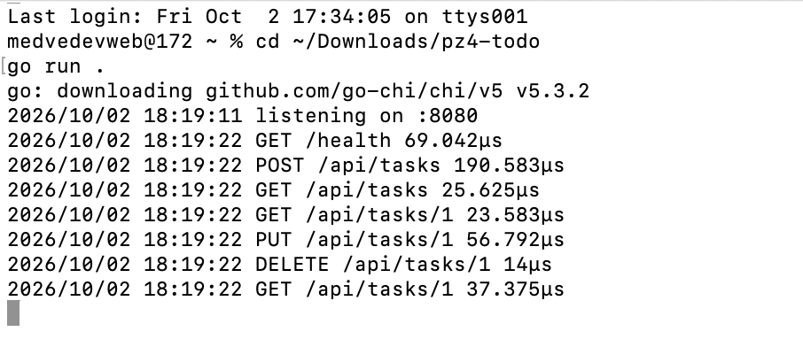
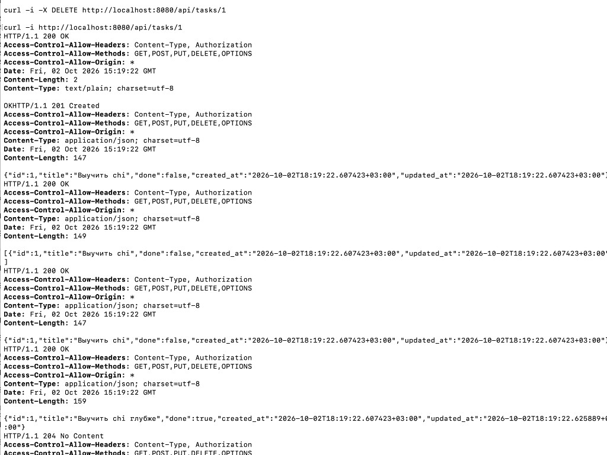

# pz4-todo (PZ4)

CRUD-сервис «Список задач» на роутере [chi](https://github.com/go-chi/chi). Данные хранятся в памяти.

## Запуск

```bash
go run .
```

## Маршруты

| Метод | Путь | Описание |
|-------|------|----------|
| GET | `/health` | проверка сервера (`OK`) |
| GET | `/api/tasks` | список задач |
| POST | `/api/tasks` | создать задачу |
| GET | `/api/tasks/{id}` | получить задачу |
| PUT | `/api/tasks/{id}` | обновить задачу |
| DELETE | `/api/tasks/{id}` | удалить задачу (`204`) |

Примеры запросов: [requests.md](requests.md).

## Структура

```text
pz4-todo/
  main.go
  go.mod
  go.sum
  internal/task/
    model.go
    repo.go
    handler.go
  pkg/middleware/
    logger.go
    cors.go
  docs/
    server-run.png
    curl-check.png
  requests.md
  README.md
```

## Скриншоты проверки

### Запуск сервера и логи



### CRUD через curl


